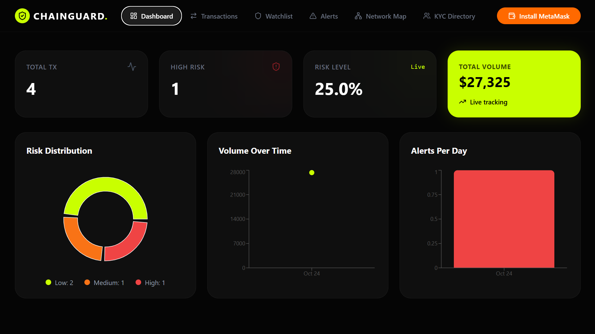
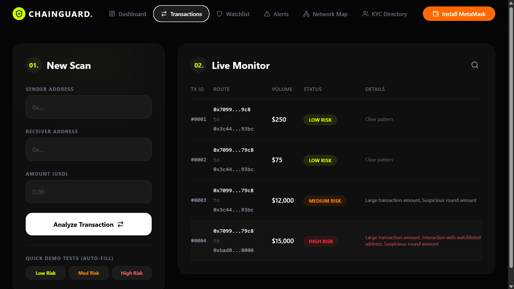
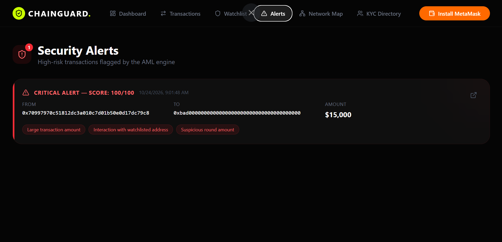
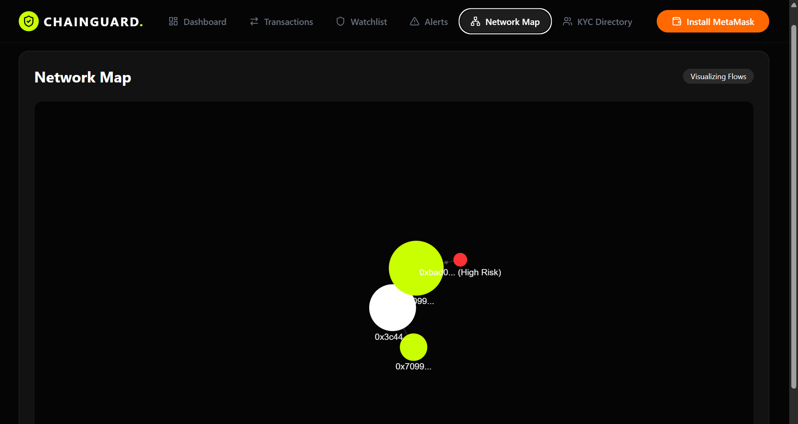

# ChainGuard AML

A blockchain-based Anti-Money Laundering (AML) monitoring MVP. Transactions are scored by a rule-based risk engine, the results are written to a Solidity smart contract on a local Hardhat chain, and a React dashboard lets a compliance officer review alerts, manage a watchlist and freeze accounts.

<!-- Add screenshots here after uploading them to the repo, for example:




-->

## Features

- **Dashboard:** total transactions, flagged count, volume over time, alerts per day and a low/medium/high risk distribution.
- **Transaction monitor:** submit a transaction (sender, receiver, amount), get a risk score, level and the reasons behind it, plus the on-chain transaction hash.
- **Alerts:** high-risk transactions listed as critical alerts, with a downloadable **SAR-style PDF report** for each one.
- **Watchlist:** add or remove addresses, and **freeze or unfreeze** an account through the smart contract.
- **Network map:** a force-directed graph of how addresses are connected.
- **KYC screen:** a searchable list of entities with risk labels (illustrative sample data, not real attributions).

## Architecture

```
React dashboard  -->  Express API (risk engine)  -->  AMLRegistry smart contract
   (Vite)               port 3001, ethers v6            local Hardhat chain
```

1. The dashboard sends a transaction to `POST /api/transactions`.
2. The backend scores it with the rule-based engine in `backend/services/amlEngine.js`.
3. The backend records the transaction and its risk score on-chain with `AMLRegistry.recordTransaction`.
4. The response (score, level, reasons, tx hash) goes back to the dashboard.

### Risk engine

Rules add to a score that is capped at 100.

| Rule | Points |
| --- | --- |
| Amount above 10,000 | +30 |
| More than 5 transactions from the same sender in 24 hours (structuring) | +40 |
| More than 15 transactions in 24 hours (high velocity) | +50 |
| Sender or receiver is on the watchlist | +80 |
| Round amount (multiple of 100, above 500) | +10 |

Levels: **LOW** below 40, **MEDIUM** from 40 to 74, **HIGH** from 75. A score of 75 or more is stored on-chain as `FLAGGED`.

### Smart contract

`contracts/contracts/AMLRegistry.sol` (Solidity 0.8.20, OpenZeppelin `AccessControl`):

- `recordTransaction`, `flagTransaction`: restricted to the `COMPLIANCE_OFFICER_ROLE`.
- `addToWatchlist`, `removeFromWatchlist`: restricted to the admin role.
- `freezeAccount`, `unfreezeAccount`, `getTransaction`, plus events for every state change.

## Tech stack

- **Smart contract:** Solidity, Hardhat, OpenZeppelin
- **Backend:** Node.js, Express 5, ethers v6
- **Frontend:** React 19, Vite, Tailwind CSS 4, Recharts, react-force-graph-2d, jsPDF

## Project structure

```
contracts/   Hardhat project (AMLRegistry.sol, deploy script)
backend/     Express API and the AML risk engine
frontend/    React dashboard
```

## Getting started

You need Node.js (a current LTS version is recommended for Hardhat) and four terminals.

### 1. Install dependencies

```bash
cd contracts && npm install
cd ../backend && npm install
cd ../frontend && npm install
```

### 2. Start a local blockchain (terminal 1)

```bash
cd contracts
npx hardhat node
```

Leave it running. It prints 20 test accounts with their private keys. These are public Hardhat development keys and hold no real funds.

### 3. Deploy the contract (terminal 2)

```bash
cd contracts
npx hardhat run scripts/deploy.js --network localhost
```

This writes the contract address and ABI to `backend/config/contract.json`. Run it again whenever you restart the Hardhat node.

### 4. Configure the backend

Copy `backend/.env.example` to `backend/.env` and set `PRIVATE_KEY` to the key of **Account #0** printed by the Hardhat node. That account deployed the contract, so it holds the admin and compliance-officer roles.

### 5. Start the backend (terminal 3)

```bash
cd backend
node index.js
```

The API runs at http://localhost:3001. If `contract.json` is missing, it starts in a mock mode without blockchain writes.

### 6. Start the dashboard (terminal 4)

```bash
cd frontend
npm run dev
```

Open http://localhost:5173.

## API

| Method | Endpoint | Description |
| --- | --- | --- |
| GET | `/api/stats` | Dashboard statistics |
| GET, POST | `/api/transactions` | List transactions, or score and record a new one |
| GET | `/api/transactions/:id` | One transaction |
| GET | `/api/alerts` | High-risk transactions |
| GET, POST | `/api/blacklist` | Read or add watchlist entries |
| DELETE | `/api/blacklist/:address` | Remove a watchlist entry |
| POST | `/api/freeze`, `/api/unfreeze` | Freeze or unfreeze an account on-chain |

## Try it

1. Open **Transactions** and submit a small transfer between two ordinary addresses. It should score **LOW**.
2. Submit a transfer of 15,000 to `0xBAD0000000000000000000000000000000000000` (already on the sample watchlist). It should score **HIGH** and appear under **Alerts**, where you can download its PDF report.

## Limitations

This is a local MVP and a learning project, not a production compliance system.

- **Data is in memory.** Transactions and the watchlist reset whenever the backend restarts. Only the on-chain records live on the Hardhat chain, which also resets when the node restarts.
- **Local network only.** It runs against a local Hardhat chain, and transactions are entered by hand in the dashboard rather than read from a real network.
- **Simple rules.** The risk engine uses fixed thresholds, with no machine learning.
- **Contract access control.** `freezeAccount` and `unfreezeAccount` have no role check, and the on-chain watchlist is not yet used by the backend. These should be restricted before any real use.
- **No authentication.** The API has no login, and CORS is open to every origin.
- **Sample data.** The KYC entries and the initial watchlist are illustrative only.

## Author

Built by **Riya Patkar** ([@riyax11](https://github.com/riyax11)).
